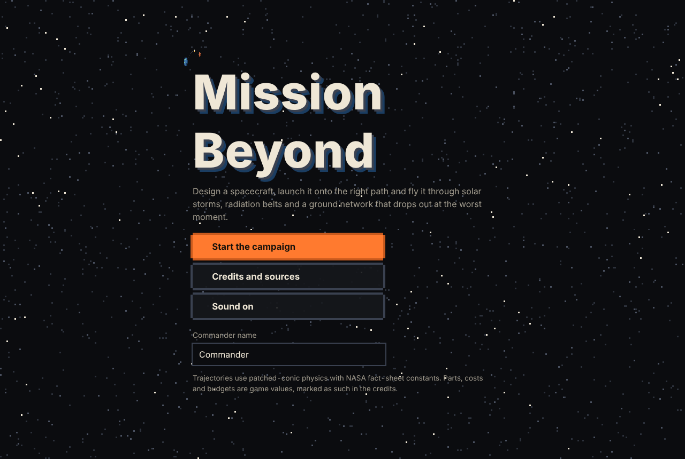
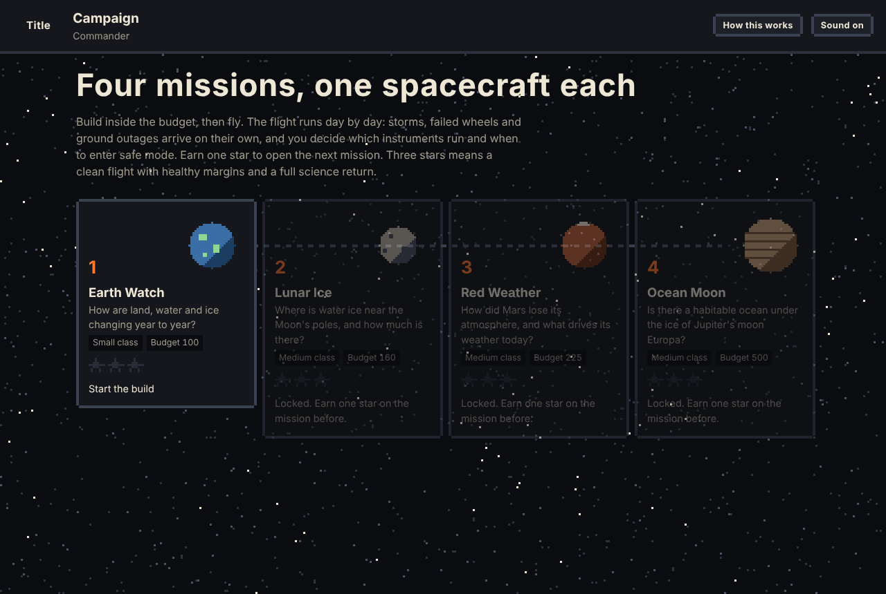
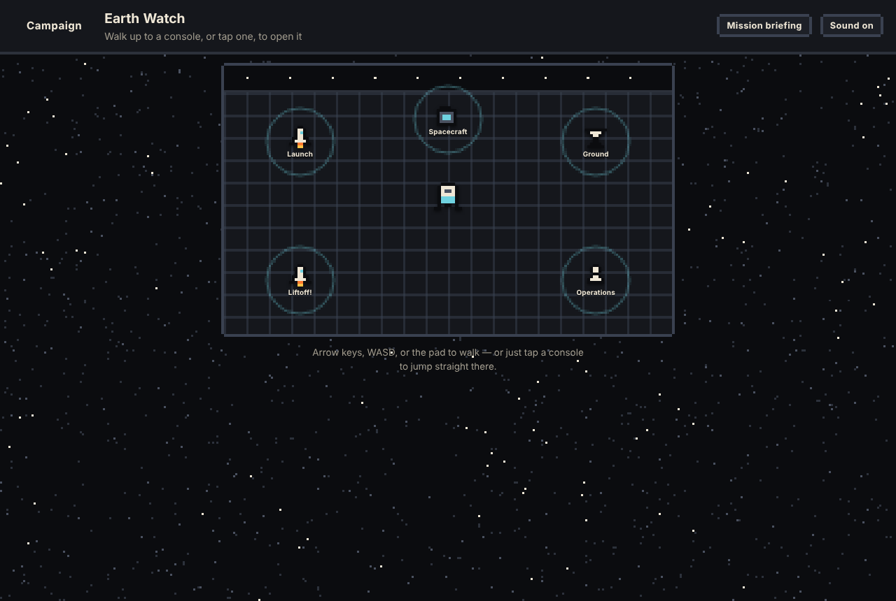
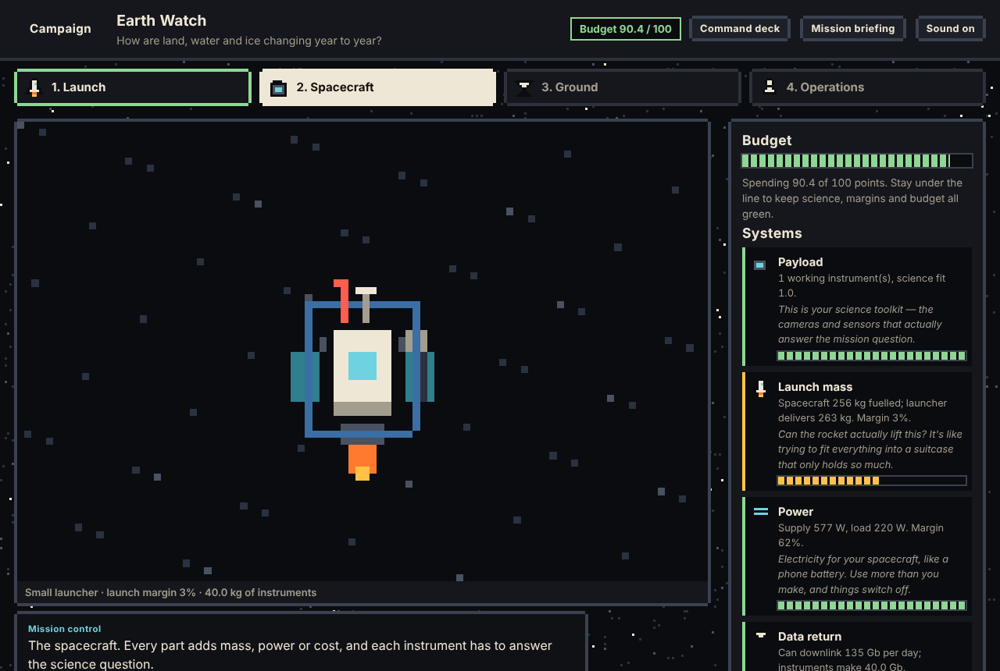
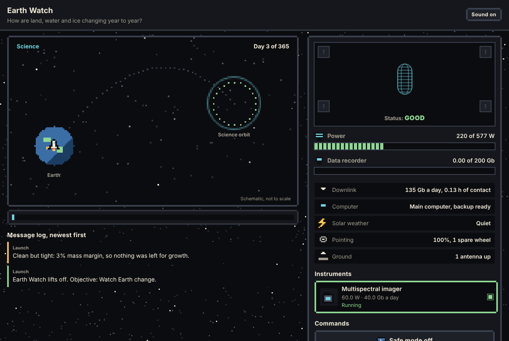

# Mission Beyond

Mission Beyond is a browser game about designing and flying a spacecraft. Build it inside a budget, launch it onto the right path, then fly it day by day through solar storms, reaction-wheel faults and ground-network outages. You decide which instruments run and when to enter safe mode. Stars are earned for a clean, well-balanced flight.

Built for the 2026 NASA Space Apps Challenge, "Space Mission Design Game".

## Screenshots

**Title screen**



**Campaign map** — four missions, unlocked one at a time



**The Command Deck** — walk between consoles with arrow keys, WASD, or an on-screen D-pad; walk up to one (or tap it) to open it



**Build bay** — every part costs mass, power, money or data; each technical check carries a plain-language explanation underneath



**Flight simulation** — a live day-by-day simulation of power, data downlink, pointing and solar-storm risk



## How to play

1. From the title screen, start (or continue) the campaign.
2. Each mission opens on the **Command Deck**: a small walkable room. Move with the arrow keys, **W A S D**, or the on-screen D-pad (shows automatically on touch screens). Walk up to a console — or just tap it — to open it. There are five consoles:
   - **Launch** — choose the launch vehicle
   - **Spacecraft** — choose the bus, power source, payload and instruments
   - **Ground** — choose the ground stations and downlink setup
   - **Operations** — choose data handling and safe-mode behavior
   - **Liftoff!** — opens once you're ready to fly
3. In the **build bay**, every part you pick shows live checks: budget, launch-mass margin, power balance, data link, and radiation shielding. Each check has a short technical readout and a second, plain-language line underneath it — no prior spaceflight knowledge required. A "Mission briefing" button replays the mission's purpose, science question and suggested age range at any time.
4. Hit **Liftoff!** (or the Launch button in the build bay) to fly. The mission clock runs one day at a time. Storms, computer faults and ground outages arrive on their own — storms are forecast two days ahead. You control instrument power switches and safe mode from the flight screen; everything else follows from the simulation in `js/sim.js`.
5. At the end of the mission you get a debrief with a score out of 100 and up to three stars. Earn at least one star to unlock the next mission.

## Run it

```
npm run serve        # then open http://localhost:8080
npm test              # 38 automated tests: physics, design rules and the flight simulation
npm run check          # every number in data.js has a source, a defined constant, or a labelled assumption
npm run credits        # regenerates CREDITS.md from the data
```

No install step and no build step. It is plain JavaScript modules and runs from any static server — including GitHub Pages (enable it in the repo's Settings → Pages, source = main branch, root folder).

## The campaign

| # | Mission | Class | Question |
|---|---------|-------|----------|
| 1 | Earth Watch | Small | How are land, water and ice changing year to year? |
| 2 | Lunar Ice | Medium | Where is water ice at the Moon's poles, and how much? |
| 3 | Red Weather | Medium | How did Mars lose its air, and what drives its weather? |
| 4 | Ocean Moon | Medium | Is there a habitable ocean under Europa's ice? |

Each mission opens with a starter build. The build bay has four stages (Launch, Spacecraft, Ground, Operations), each with slot tiles and a parts tray. Each part shows whether it holds its check, and how much it moves the budget. Earn one star to unlock the next mission.

In flight, the clock runs one mission day at a time. Storms, faults and outages arrive on their own, forecast where possible. You control the instrument switches and safe mode. Everything else follows from the simulation in `js/sim.js`.

## Where the numbers come from

Every value in `js/data.js` carries one tag:

- `src`: a published NASA or JPL source, listed in `SOURCES`
- `defined`: an exact SI or IAU constant
- `assumption`: a game value that is not real data, with the reason

Trajectory figures use patched-conic formulas (Hohmann transfers between circular, coplanar orbits) measured from one 300 km parking orbit. Launchers, instruments, radios, ground stations, costs and budgets are generic game values, not real hardware or prices. Storm rates, upset chances, fault and outage rates, and the recorder size are also game values, not real data.

`CREDITS.md` lists every source and constant. Code and original content are licensed under Apache 2.0 (see `LICENSE`).

## Files

- `index.html`, `css/style.css`: the page and the console styling
- `js/ui.js`: screens, the Command Deck hub, build bay, flight canvas, debrief
- `js/pixel.js`: hand-drawn pixel-art sprites and canvas drawing helpers
- `js/engine.js`: design evaluation, the trajectory and link figures, stars
- `js/sim.js`: the day-by-day flight simulation and its score (no screen code)
- `js/missions.js`: the four campaign missions and their starter builds
- `js/data.js`: sources, constants, parts, budgets
- `js/physics.js`: orbital and link-budget formulas
- `js/audio.js`: synthesized sound effects (no audio files)
- `tests/`: automated tests; `scripts/`: source check and credits generator
- `screenshots/`: the images used in this README
